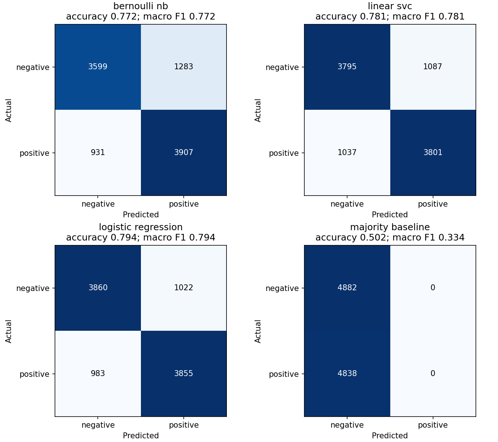

# Sentiment Analysis with TF-IDF

An academic Python project comparing Bernoulli Naive Bayes, Linear SVC and Logistic Regression for positive/negative sentiment classification. The workflow prepares Sentiment140 text, checks duplicate overlap, trains the three classifiers and saves a complete prediction pipeline.

[CI checks](https://github.com/Parisa6Izadyar/Sentiment-Analysis2/actions/workflows/tests.yml) · [Methods](docs/methodology.md) · [Recorded metrics](results/benchmark/metrics.json)

## Run in Codespaces

[Open in GitHub Codespaces](https://codespaces.new/Parisa6Izadyar/Sentiment-Analysis2?ref=main)

When testing a pull request, select its branch in the Codespaces dialog. The dev container installs Python 3.12 and the pinned dependencies. Once setup finishes, run:

```bash
python -m pytest -q
python -m sentiment_analysis train --download --sample-size 100000
```

The first benchmark run downloads an approximately 78 MiB archive. No API key or NLTK corpus download is required. Later runs reuse the local CSVs. The command prints each training stage and ends with `Finished. Results: ...`.

For an offline installation check, use `python -m sentiment_analysis demo`. Its 120 synthetic examples exercise the workflow; their scores are not benchmark results.

## Local setup

The workflow is tested with Python 3.12 on Linux.

```bash
python -m venv .venv
source .venv/bin/activate
python -m pip install -r requirements.txt
python -m pytest -q
python -m sentiment_analysis train --download --sample-size 100000
```

On Windows activate the environment with `.venv\Scripts\activate`. Other platforms are not covered by CI.

To use downloaded files directly:

```bash
python -m sentiment_analysis train \
  --data data/training.1600000.processed.noemoticon.csv \
  --manual-test data/testdata.manual.2009.06.14.csv \
  --sample-size 100000
```

The original entry point remains available: `python HS_Project_Z.py train --download --sample-size 100000`. Use `--help` to see the commands. `--sample-size 0` uses the full training file and needs more memory and time; the recorded benchmark uses a 100,000-row sample.

## Recorded results

The source training file has 1,600,000 weakly labelled tweets. A stratified sample of **100,000 rows**, seed 42, retained **97,195 distinct processed texts** after cleaning. These were split into **77,755 training**, **9,720 validation** and **9,720 test** examples. TF-IDF learned **88,475 features from training text only**.

The three classifier settings were fixed before evaluation. Logistic Regression was selected using validation macro F1; the table reports the subsequent test results for all predefined candidates and a majority-class baseline.

| Model | Validation macro F1 | Test accuracy | Test macro F1 | Test ROC AUC |
| --- | ---: | ---: | ---: | ---: |
| Bernoulli NB | 0.7700 | 77.22% | 0.7720 | 0.8547 |
| Linear SVC | 0.7818 | 78.15% | 0.7815 | 0.8626 |
| Logistic Regression | **0.7957** | **79.37%** | **0.7937** | **0.8763** |
| Majority baseline | 0.3343 | 50.23% | 0.3343 | 0.5000 |

The selected Logistic Regression pipeline also scored **79.94% accuracy** and **0.7986 macro F1** on the official manual test file's **359 positive/negative examples**. Its 139 neutral examples were excluded because the model has two classes. These test examples were not used to select or fit the model. No processed-text overlap was found between this test file and the sampled development data.



These are measurements from this sample and split, rather than a benchmark on all 1.6 million training tweets. See the [full-precision manifest](results/benchmark/metrics.json) and [evaluation notes](docs/validation.md) for provenance and limits.

## Use the saved model

```bash
python -m sentiment_analysis predict \
  --model results/reproduced/sentiment_pipeline.joblib \
  --text "I really enjoyed this film" "The service was awful"
```

The saved pipeline includes text processing, the fitted TF-IDF vectorizer and the selected classifier. Training and prediction use the same tokenizer. Load model files produced by this workflow or another trusted source; joblib files are Python serialized objects.

## Outputs

A benchmark run writes to `results/reproduced/`:

| File | Contents |
| --- | --- |
| `metrics.json` | Data checksums, cleaning counts, split sizes, model settings and metrics |
| `confusion_matrices.png` | Counts and scores for each classifier and the baseline |
| `sentiment_pipeline.joblib` | Fitted vectorizer and selected classifier |
| `test_predictions.csv` | Source row, label and predictions for the held-out sample |
| `train_rows.csv`, `validation_rows.csv`, `test_rows.csv` | Reproducible row assignments |

The output folder and downloaded source data are ignored by Git. The small checked-in `results/benchmark/` summary and plot record the verified run. The other images in `results/` are from the original project and use a different evaluation protocol.

## Project structure

- `HS_Project_Z.py`: command-line entry point retained for existing links.
- `sentiment_analysis/`: text processing, data checks, training, evaluation and prediction.
- `tests/`: regression and integration checks.
- `data/demo.csv`: synthetic examples for offline checks.
- `docs/`: data preparation and evaluation details.

## Data source and limitations

Sentiment140 was introduced by Alec Go, Richa Bhayani and Lei Huang in [Twitter Sentiment Classification using Distant Supervision](https://cs.stanford.edu/people/alecmgo/papers/TwitterDistantSupervision09.pdf), 2009. The downloader uses the original Stanford archive, with the identical archive from [Microsoft's SynapseML example](https://microsoft.github.io/SynapseML/docs/Explore%20Algorithms/Classification/Quickstart%20-%20Vowpal%20Wabbit%20on%20Text%20Data/) as a fallback, checking its SHA-256.

Training labels are noisy, and the texts reflect English Twitter usage from 2009. A stratified random split does not establish performance on new authors or future periods. The classifier has no neutral class, and sarcasm or domain changes can cause errors. The original WordNet preprocessing and 5% test split differ from this workflow, so the old figures are not directly comparable with the recorded results.
